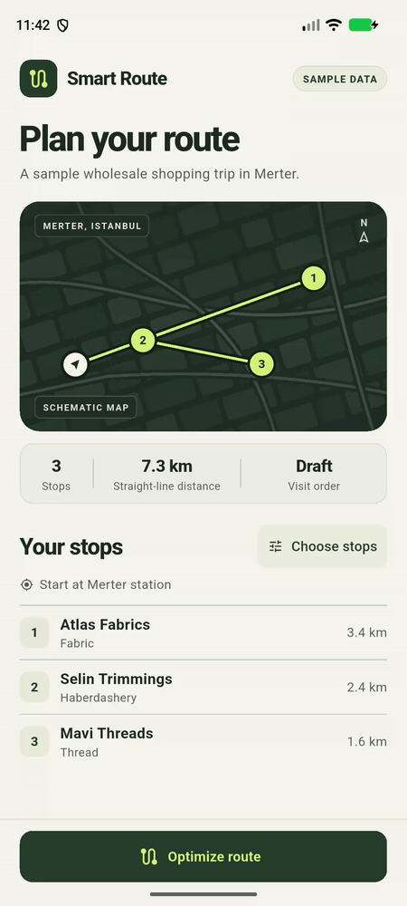

# Smart Route

Smart Route is a Flutter prototype for planning a wholesale shopping trip. Choose sample shops in Merter, Istanbul, then compare the visit order and straight-line distance before and after optimization.

## Demo



Tap **Optimize route** to update the numbered map and itinerary. The recording shows the planner running on a Pixel 8 emulator.

[Draft route screenshot](docs/media/route-draft.png) · [Optimized route screenshot](docs/media/route-optimized.png) · [Stop picker screenshot](docs/media/route-stop-picker.png)

## Try the planner

1. Open **Choose stops** and select shops from the six sample locations. Tap **Apply stops** to update the draft.
2. Tap **Optimize route** with at least two shops selected. Smart Route compares visit orders from Merter station and updates the numbered map markers and itinerary.
3. Tap **Restore original order** to compare with your draft.

The default draft visits Atlas Fabrics, Selin Trimmings, and Mavi Threads in that order. Optimization moves Selin Trimmings to the first stop and puts Atlas Fabrics last. The calculated distance drops from **7.3 km to 4.0 km**.

## Run locally

Start with Flutter 3.47.8 and its bundled Dart 3.13.7, the toolchain used for this checkout. For iOS, install Xcode with a simulator runtime. For Android, install the Android SDK and use JDK 17 with the pinned Gradle wrapper.

```sh
git clone https://github.com/faroqomar/smart_route.git
cd smart_route
flutter pub get
flutter devices
flutter run -d <device-id>
```

Replace `<device-id>` with an ID from `flutter devices`. Smart Route opens to **Plan your route** with a three-stop draft. The planner runs on the device without an account, API key, or backend.

## Prototype scope

The schematic map uses fictional shop positions and a fixed departure point. Each calculation minimizes straight-line distance and ends at the final shop. Route changes last for the current app session.

The project plans cover real store records, map links, road routing, and navigation. [MVP definition](MVP.md) · [Roadmap](Roadmap.md)

## Development

```sh
flutter analyze
flutter test
```

The widget tests cover optimizing and restoring the draft, editing the stop selection, and the empty state. The planner lives in `lib/main.dart`, the route search in `lib/route_plan.dart`, and the schematic in `lib/route_map.dart`.

This repository has no license file.
